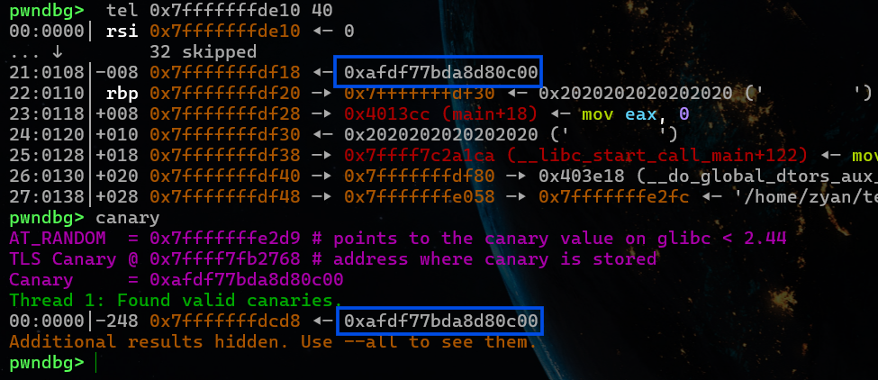
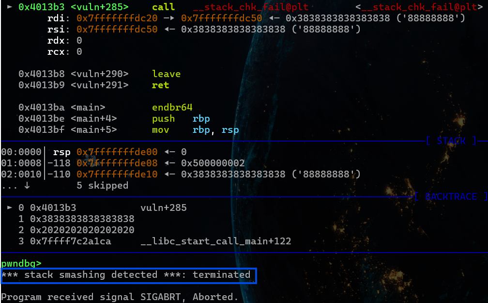

# PIE
Các hệ điều hành có một cơ chế bảo mật gọi là ASLR (viết tắt của Address Space Layout Randomization) sẽ sắp xếp ngẫu nhiên vị trí các vùng nhớ dùng cho chương trình khi chạy. Điều này chống lại việc những người khai thác lỗ hổng truy cập Stack, Heap, Libraries (Libc) nằm ở các địa chỉ cố định.

Tuy nhiên mục Code/ Data segment không được sắp địa chỉ ngẫu nhiên bới ASLR, tạo ra lỗ hổng dễ bị khai thác. Và cơ chế bảo mật PIE khắc phục điều đó làm cho địa chỉ Code/ Data segment không còn cố định.

Điều này khiến cho việc sử dụng Gadget và tìm địa chỉ hàm trong chương trình trở nên khó khăn hơn.

# NX
Khi cơ chế NX bật thì các địa chỉ thuộc vùng Stack/Heap sẽ được gắn cờ read/write only và không thể thực thi. Khi người khai thác lỗ hổng chèn shellcode vào vùng Stack thì sẽ từ chối thực thi và dừng chương trình.

# Canary
Cơ chế bảo vệ Canary là cơ chế giúp phát hiện và ngăn chặn các cuộc tấn công bằng buffer overflow nhắm vào return address.

Khi bật Canary, chương trình sẽ chèn thêm một giá trị ngẫu nhiên gọi là Canary vào trước return address. Trước khi thực hiện ret, chương trình sẽ kiểm tra xem giá trị đó có bị thay đổi hay không. Nếu có, chương trình sẽ bị ngắt để tránh việc quyền điều khiển bị chiếm.

Đặc điểm của Canary: Nằm ngay trước saved rbp và BYTE cuối là NULL BYTE

Khi Canary bị ghi đè thì lúc hàm chuẩn bị return sẽ phát hiện Canary không giống với giá trị ban đầu. Do đó chương trình bị thoát ngay lập tức.

# RELRO 
## Partial RELRO
Reorder (sắp xếp lại) các phần bộ nhớ để bảng `GOT`, `.dynamic`, `.fini_array`, `.init_array` nằm trước các biến toàn cục (vùng .data / .bss). Điều này giúp ngăn ngừa việc tràn bộ đệm từ vùng dữ liệu thường ghi đè vào GOT.

Phần `.got.plt` (chứa địa chỉ các hàm liên kết động) vẫn dùng Lazy Binding và có quyền Read-Write `rw-`.

## Full RELRO
Tắt hoàn toàn Lazy Binding: Ngay khi chương trình vừa khởi chạy, Dynamic Linker (ld.so) sẽ lập tức phân giải địa chỉ cho toàn bộ các hàm thư viện và điền sẵn vào bảng GOT.

Sau khi điền xong, Linker gọi hàm hệ thống `mprotect()` để đổi quyền hạn của toàn bộ vùng nhớ GOT từ `rw-` thành `r--`.
